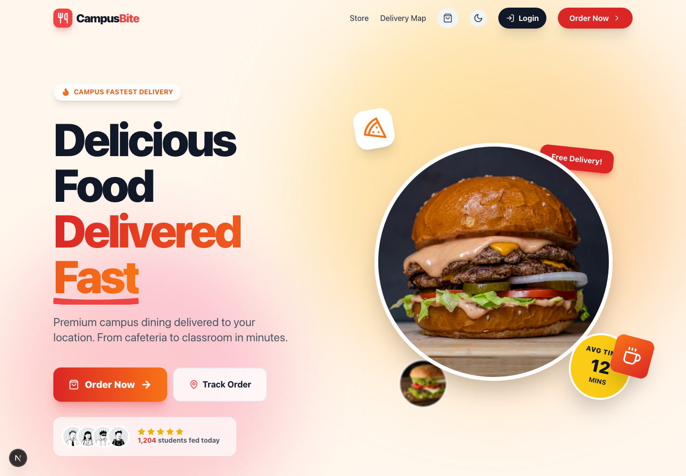
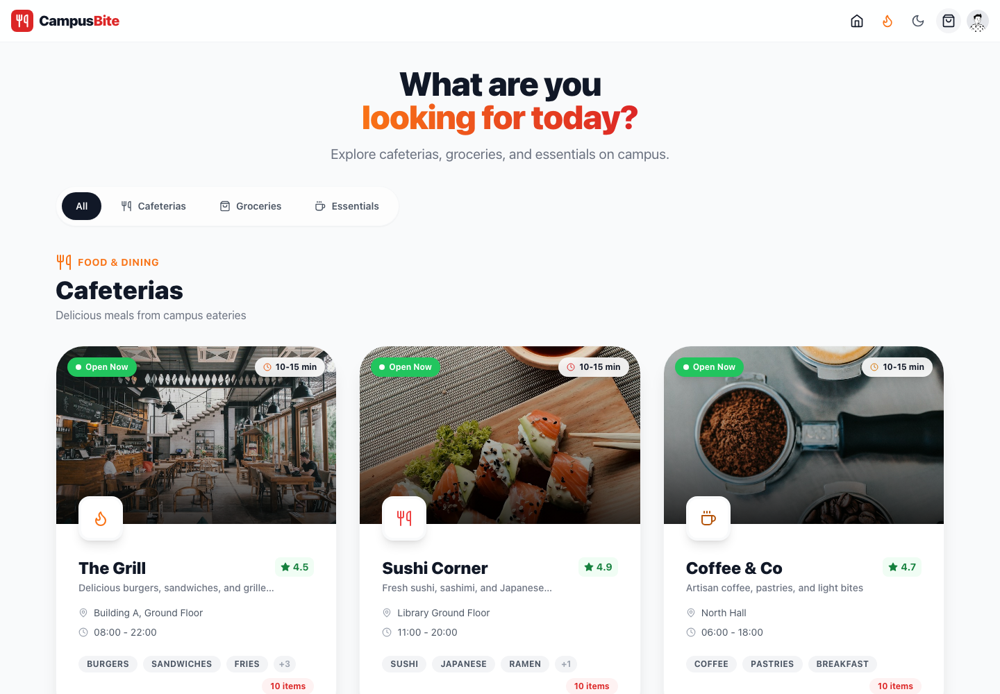

# CampusBite

A campus ordering prototype for finding food, groceries and essentials in one place. The student-facing flow covers browsing campus vendors, opening a menu, building an order and following its status. Partner screens support menu and order management.

## Main flows

- Browse cafeterias, groceries and campus essentials.
- Open a vendor and view its menu.
- Build a cart and submit an order.
- Track order status and preparation estimates.
- Partner dashboard for incoming orders, menus and settings.
- Student profile and order history.
- Admin route for managing the prototype.

## Tech

- Next.js App Router
- React and TypeScript
- Tailwind CSS
- Browser storage for demo order state

## Run locally

~~~sh
npm ci
npm run dev
~~~

Open http://localhost:3000. The repository includes an .env.example for optional integrations; use your own development credentials if you wire up external services.

## Current boundaries

This is a prototype, not a production ordering or payment service. Order state is stored in browser localStorage and synchronized between tabs; partner updates use polling, so this is not a real-time server-backed workflow. No live payment gateway is connected. The UI uses sample campus vendors and menu data.

## Author

Built by [Om Rashiya](https://github.com/rashiyaom).
